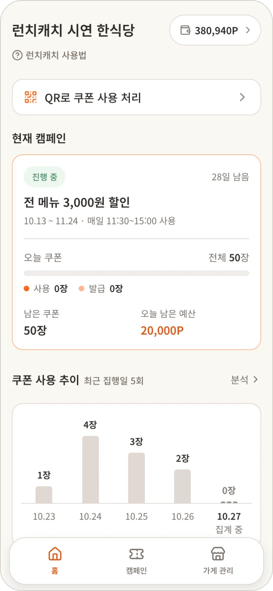
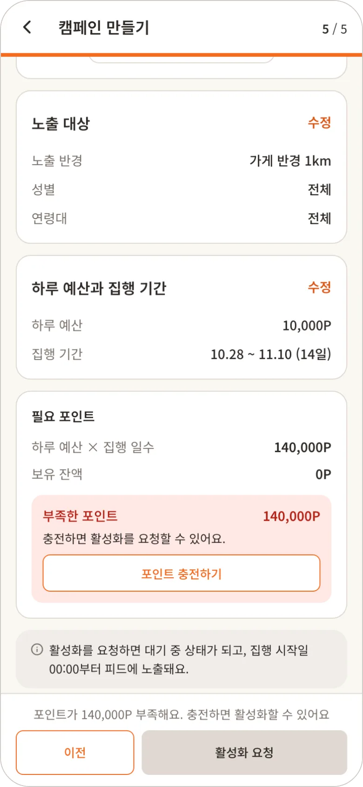

# 🍱 런치캐치 · 점주 앱

> 주변 가게와 직장인을 점심 쿠폰으로 이어주는 위치 기반 쿠폰 플랫폼 **런치캐치**의 점주 앱
>
> 🏆 유레카 융합 프로젝트 최우수상

| 홈 | 포스터 만들기 | 캠페인 확인 |
| :---: | :---: | :---: |
|  |  |  |

<br>

## 이 저장소에 대해

- **원본**: 팀 저장소 [lunch-catch/lc-frontend](https://github.com/lunch-catch/lc-frontend) (2026.09.09 ~ 2026.10.28, 프론트엔드 3 · 백엔드 5)
- 원본에서 제가 맡은 **점주 앱과 공통 패키지만 커밋 기록과 함께 가져와**, 프로젝트가 끝난 뒤에도 이어서 다듬는 개인 저장소입니다.
- 원본과 다른 점
  - 사용자 앱과 관리자 앱은 뺐습니다. 두 앱은 원본 저장소에서 볼 수 있습니다.
  - 서비스 도메인과 API 서버는 프로젝트가 끝나 내려갔습니다. 지금은 화면을 열면 로그인 정보 확인에서 멈춥니다. 서버 없이 화면을 볼 수 있도록 목 데이터 작업을 할 예정입니다.
- 커밋 메시지와 문서의 이슈 · PR 번호(`#315` 등)는 **원본 저장소 기준**입니다. 원본의 [Issues](https://github.com/lunch-catch/lc-frontend/issues?q=is%3Aissue)와 [Pull requests](https://github.com/lunch-catch/lc-frontend/pulls?q=is%3Apr)에서 찾을 수 있습니다.

<br>

## 서비스 소개

- **문제**: 직장인은 점심값이 부담되고, 동네 가게 사장님은 적은 비용으로 점심 손님을 모을 방법이 부족합니다.
- **해결**: 사장님은 관리자가 LLM으로 만든 템플릿에 가게 정보만 채워 쿠폰 포스터를 올리고, 주변 직장인은 찜해 둔 쿠폰을 11:00 선착순으로 받아 매장에서 QR로 씁니다.


점주 앱의 서비스 규칙, 주요 화면, 구현 고민은 [점주 앱 README](apps/owner/README.md)에 정리했습니다.

<br>

## 맡은 일

**이규태 [@Ourumo](https://github.com/Ourumo)** · FE 파트장 · 점주 앱 전담

- **개발 환경**: Vite · React 프로젝트 생성, ESLint · Prettier · Husky 도입, npm 단일 앱을 pnpm workspaces + Turborepo 모노레포로 전환, import 경로 규칙을 ESLint 규칙으로 직접 작성(`packages/eslint-config/rules`), CodeRabbit 자동 리뷰 설정
- **점주 앱 전체**: 입점 신청 6단계(단계별 저장 · 이어하기, 카카오 지도 장소 검색, S3 사진 업로드), 캠페인 등록 · 포스터 · 상태별 처리, 토스페이먼츠 포인트 충전 · 내역 · 환불, QR 쿠폰 사용 처리, 가게 분석, 토큰 재발급과 탭 간 로그인 상태 동기화

### 함께한 사람

| 이름 | 역할 |
| --- | --- |
| 고유정 [@daenggg](https://github.com/daenggg) | 관리자 앱. 공통 컴포넌트 12종(`@repo/ui`)과 Tailwind · Storybook 초기 설정 |
| 서지현 [@jhwest-dev](https://github.com/jhwest-dev) | 사용자 앱 |
| 백엔드 5명 | 원본 저장소 [팀원 소개](https://github.com/lunch-catch/lc-frontend#팀원-소개) 참고 · [lc-backend](https://github.com/lunch-catch/lc-backend) |

<br>

## 기술 스택

| 구분 | 기술 |
| --- | --- |
| Frontend | React 19, TypeScript, Vite 8, React Router, Tailwind CSS v4 |
| Monorepo | pnpm workspaces, Turborepo |
| UI · 문서 | Storybook 10, Vitest (`@repo/ui` 공통 컴포넌트) |
| 코드 품질 | ESLint, Prettier, Husky, lint-staged |
| 지도 · 결제 | Kakao Maps JavaScript SDK (장소 검색), Toss Payments 결제위젯 (포인트 충전) |
| QR 인식 | BarcodeDetector, ZXing WASM (iOS Safari 대체) |
| 배포 | Vercel |

<br>

## 포팅 매뉴얼

### 요구 사항

- Node.js: Vite 8 기준 `20.19` 이상 또는 `22.12` 이상
- pnpm: 루트 `package.json`의 `packageManager` 버전을 corepack이 자동으로 사용

### 설치와 실행

```bash
git clone https://github.com/Ourumo/lunchcatch-owner.git
cd lunchcatch-owner

# Node 25 이상이라면 먼저 실행
npm install -g corepack

corepack enable pnpm
pnpm install

pnpm dev:owner   # http://localhost:5174
```

- `pnpm install`이 끝나면 Husky가 커밋 전 검사(ESLint, Prettier)를 자동 설정
- API 서버가 필요합니다. 원본 백엔드 [lc-backend](https://github.com/lunch-catch/lc-backend)를 로컬(`http://localhost:8080`)에서 실행하면 Vite 프록시가 `/v1` 요청을 넘깁니다.
- 환경 변수는 `apps/owner/.env.local`에 넣습니다. 항목은 [`apps/owner/.env.example`](apps/owner/.env.example)과 [점주 앱 README](apps/owner/README.md#실행)에 있습니다.

### 빌드와 검사

| 명령어 | 설명 |
| --- | --- |
| `pnpm build` | 점주 앱 빌드 (타입 검사 포함) |
| `pnpm lint` | ESLint 검사 |
| `pnpm typecheck` | 타입 검사 |
| `pnpm format:check` | Prettier 검사 |
| `pnpm storybook` | 공통 · 점주 컴포넌트 Storybook (http://localhost:6006) |
| `pnpm test:storybook` | Storybook 테스트 (접근성 검사 포함) |

- Storybook 테스트는 Playwright 브라우저로 돌아가서, 처음 한 번 `pnpm exec playwright install chromium-headless-shell` 필요

<br>

## 폴더 구조

```
lunchcatch-owner/
├── apps/
│   ├── owner/             # 점주 앱
│   └── storybook/         # 공통 · 점주 컴포넌트 문서와 테스트
├── packages/
│   ├── ui/                # @repo/ui: 공통 컴포넌트, 디자인 토큰, 전역 스타일
│   ├── utils/             # @repo/utils: React와 DOM에 의존하지 않는 순수 함수
│   ├── tsconfig/          # 공통 TypeScript 설정
│   └── eslint-config/     # 공통 ESLint 설정과 import 경로 규칙
└── docs/                  # 점주 · 공통 요구사항 명세, 폴더 구조, 컨벤션, 배포
```

- 앱 내부 구조: [점주 앱 README](apps/owner/README.md#폴더-구조)
- 자세한 규칙: [docs/folder-structure.md](docs/folder-structure.md), [docs/conventions.md](docs/conventions.md)
